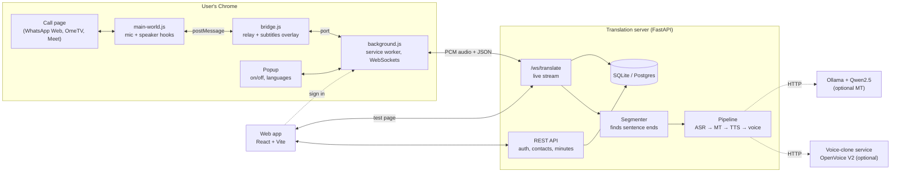
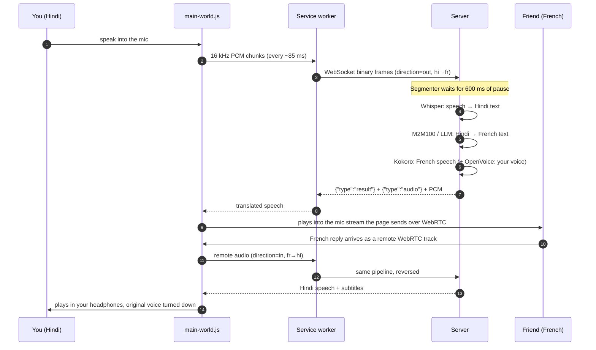
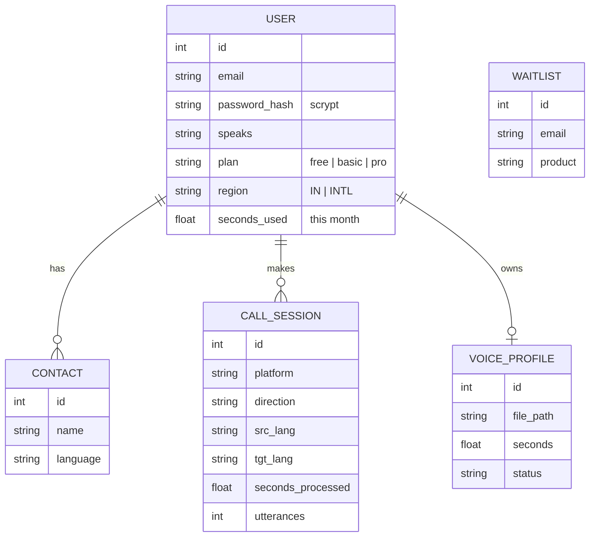

# BolBridge system design

Version 0.1 · October 2026

## 1. Goal

Two people who do not share a language talk on a normal web call. Each speaks
their own language; each hears the other in their own language, ideally in the
speaker's own voice. Only one of them needs BolBridge.

Constraints that shaped the design:

- **The other person installs nothing.** So we cannot run on their device. We
  sit on *our* user's side of the call and change what goes in and out.
- **Phones block apps from call audio** (Android and iOS). So version 1 runs in
  the desktop browser (WhatsApp Web, OmeTV, Google Meet, Zoom web).
- **Open-source models only**, with licences that allow commercial use.
- **Cheap to run** in India, and fair on minutes.

## 2. Components

| Part | Responsibility | Key files |
| --- | --- | --- |
| `main-world.js` | Runs inside the call page before its own code. Replaces the microphone the page gets with one we control; listens to every incoming WebRTC audio track; plays translated speech; turns the original voice down. | `extension/src/content/main-world.js` |
| `bridge.js` | Moves audio between the page and the service worker (base64 over a port). Draws the status pill and subtitles in a closed shadow DOM. | `extension/src/content/bridge.js` |
| `background.js` | One WebSocket per direction per call frame. Reconnects when settings change. Falls back to the real voice if the server is unreachable. Receives sign-in from the web app. | `extension/src/background.js` |
| Server REST | Accounts (scrypt passwords, JWT), contacts, minutes per plan, voice sample, waitlist. | `server/app/routers/` |
| Server stream | Receives 16 kHz PCM, cuts sentences, runs the pipeline, streams text + audio back, meters minutes, saves call history. | `server/app/realtime/` |
| Pipeline | Engine-agnostic: any ASR, translator, TTS, voice converter that fits the interfaces. | `server/app/pipeline.py`, `server/app/engines/` |
| Web app | Landing hub, contextual sign-up, dashboard, translator test page, voice recording, plan, previews of the next products. | `web/src/` |

## 3. How a sentence travels

### The two audio tricks

1. **Outgoing (your voice to them).** `navigator.mediaDevices.getUserMedia` is
   wrapped. The page receives a `MediaStreamAudioDestinationNode` track fed by
   two gains: your real voice (on when translation is off) and the translated
   speech (on when translation is on). The page's own mute button keeps working
   because we check `track.enabled` before sending audio to the server.
2. **Incoming (their voice to you).** `RTCPeerConnection` is wrapped so every
   remote audio track is also routed into Web Audio. A muted helper `<audio>`
   element keeps Chrome feeding the remote stream into Web Audio. The page's
   own media elements are found by watching `srcObject`, and their volume is set
   to 0 (or 15% with "hear their real voice softly").

No virtual audio driver is needed, which is the main difference from desktop
tools that ask users to install VB-CABLE.

### Safety nets

- Server unreachable, out of minutes or logged out → the extension switches
  that direction back to the real voice, so nobody is left in silence.
- Turning translation off closes the streams at once.
- A language with no open-source voice yet (Arabic, Tamil…) still gets
  subtitles; the other person hears the real voice.
- More than 4 sentences waiting → the oldest is skipped to stay live.

## 4. Turn-taking (when a sentence ends)

`server/app/realtime/segmenter.py` is an energy-based voice activity detector
with an adaptive noise floor:

- 20 ms frames; speech starts after 60 ms above the threshold
  (`max(-45 dBFS, noise floor + 10 dB)`); 300 ms of audio before that is kept.
- A sentence ends after 600 ms of quiet (`VAD_END_SILENCE_MS`), or at 12 s.
- Fewer than 200 ms of actual voice (clicks, coughs) is ignored.

This trades a little delay for whole sentences, which translate far better than
fragments. See "Latency" for the next step.

## 5. Latency budget (target for one sentence)

| Step | CPU laptop (i5/i7) | NVIDIA GPU (T4/RTX) |
| --- | --- | --- |
| Wait for end of sentence | 600 ms | 600 ms |
| Whisper small, int8 | 0.6–1.5 s | 0.1–0.3 s |
| M2M100 418M | 0.3–0.8 s | 0.05–0.15 s |
| Kokoro-82M | 0.3–0.8 s | 0.05–0.15 s |
| Network (India region) | 50–150 ms | 50–150 ms |
| **Total after you stop speaking** | **about 2–4 s** | **about 1–1.5 s** |

These are planning estimates; measure on your hardware with the timings shown on
the "Try the translator" page. Google Meet's own translation runs a few seconds
behind, so 1–2 s is acceptable for business calls.

**Next latency steps:** stream partial ASR results while the person is still
talking; translate per clause; start TTS on the first clause; lower
`VAD_END_SILENCE_MS` to 400 ms once the models are fast.

## 6. Data model

We store call **details** (who, where, languages, length), never call audio or
transcripts. Voice samples are stored only with consent and deleted on request.

## 7. APIs

Full reference: [API.md](API.md). Summary:

- `POST /api/auth/signup`, `POST /api/auth/login` → JWT
- `GET/PATCH /api/me`, `GET /api/usage`, `POST /api/me/plan` (dev only)
- `GET/POST/PATCH/DELETE /api/contacts`
- `GET /api/calls`
- `GET/POST/DELETE /api/voice`
- `POST /api/waitlist`
- `WS /ws/translate?src=hi&tgt=fr&direction=out&token=…`

## 8. Security and privacy

- Passwords: scrypt (standard library). Sessions: JWT (HS256, 30 days).
  Set a long `SECRET_KEY` in production; the server refuses to start without one.
- No audio or transcripts stored. Call history keeps metadata only.
- Voice cloning: opt-in with explicit consent text; profile tied to the
  account owner; one-click delete; OpenVoice watermarks every cloned clip.
- Optional "this call is translated" notice spoken to the other person.
- The extension never gives the page its account key; the page and extension
  share only audio and on/off state.
- India DPDP Act 2023: consent screens, deletion, data kept in India (deploy in
  a Mumbai region), privacy policy before the first pilot.
- Platform rules: no bots join calls; we only change the user's own audio.
  Check OmeTV's and other platforms' terms before marketing there.

## 9. Scaling plan

| Stage | Users at once | Setup |
| --- | --- | --- |
| Pilot | 1–20 | One GPU machine (or a good CPU) running everything; SQLite |
| Launch | 20–200 | Postgres; API servers separate from GPU workers; Redis queue between them; models loaded once per worker |
| Growth | 200+ | Autoscaled GPU workers per language group; faster streaming models; regional servers (Mumbai, then Singapore/Frankfurt); per-minute API for businesses |

Today the pipeline runs in-process with one lock per model. Moving to workers
means replacing `run_in_executor` in `realtime/session.py` with a queue call;
the WebSocket protocol does not change.

**Cost per call-minute** (self-hosted, rough): a single T4-class GPU at about
₹30–60 per hour can serve roughly 10–20 people talking at once, so about
₹0.1–0.5 per translated minute, versus ₹3–6 with paid APIs.

## 10. What comes next

- **Mobile:** phones cannot capture WhatsApp calls, so mobile uses a translated
  call link (WebRTC room hosted by BolBridge; the friend opens a link).
- **AI tutor:** same ASR and TTS; an open LLM plays the tutor; an open
  talking-head model animates a realistic face (check each model's licence).
- **Talk to the World:** our own WebRTC rooms (signalling server, TURN relay),
  random matching by language/country, moderation (nudity and abuse detection),
  18+ only.
- **Business API:** the same `/ws/translate` protocol, sold per minute to call
  centres.
